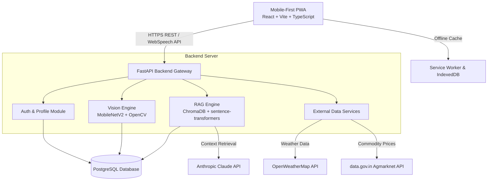
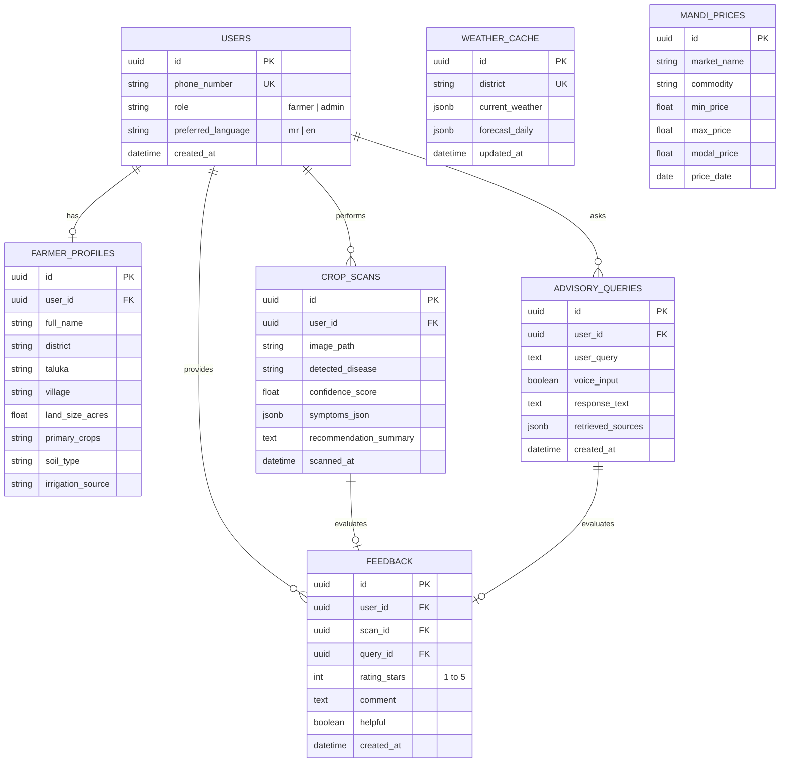
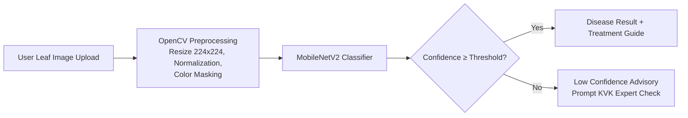
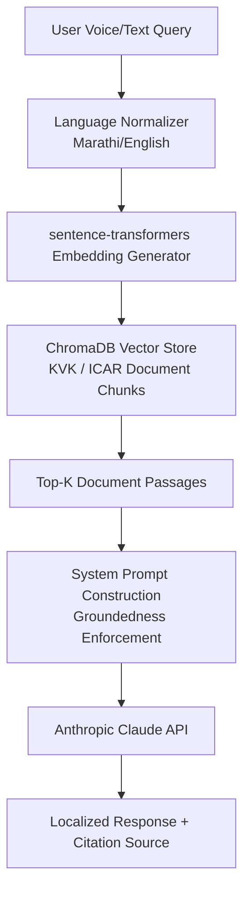
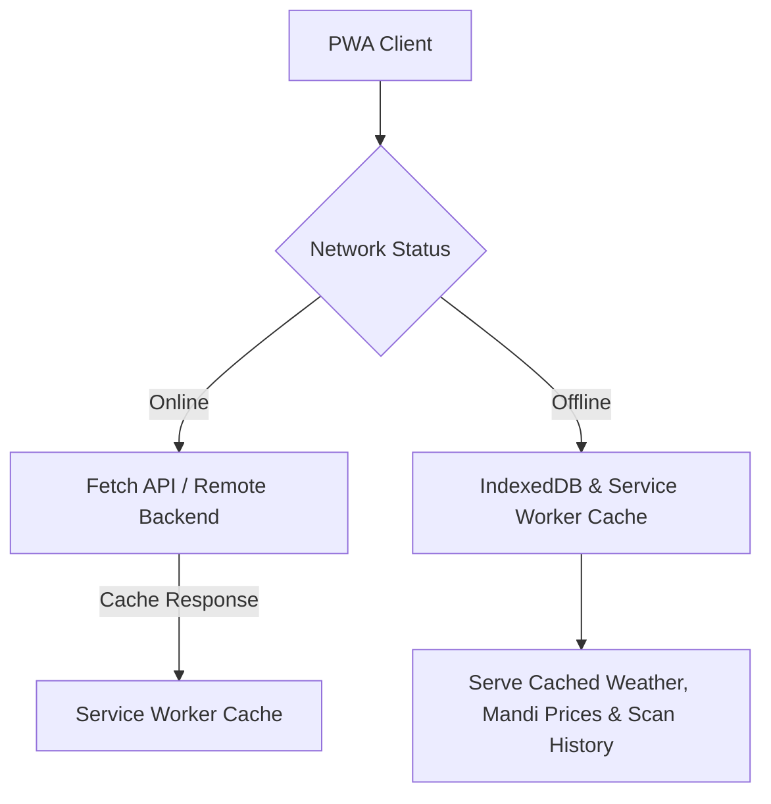
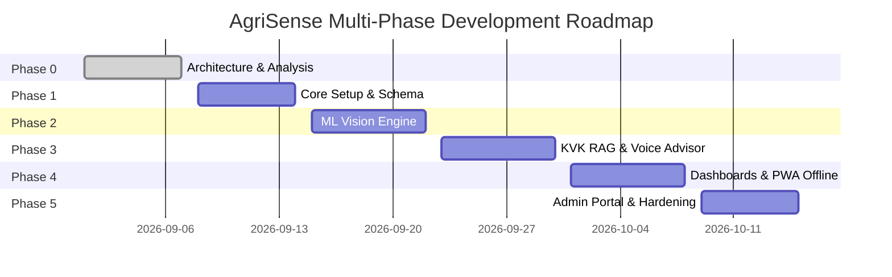

# AgriSense — System Architecture Specification

## 1. Current Project Analysis

### Repository & Workspace Status
- **Workspace Location**: `c:\Users\yashs\OneDrive\Desktop\Agrisense`
- **Current State**: Fresh repository setup (Phase 0). No pre-existing legacy code or conflicting frameworks.
- **Primary Source Documents**:
  1. *Assignment 1 — Needs Assessment*
  2. *Assignment 2 — Project Proposal*

### Key Empirical Survey Findings
The technical architecture is directly grounded in empirical findings from the Needs Assessment report conducted among smallholder farmers in Maharashtra:
- **97.1% Smartphone Ownership**: Validates targeting a modern mobile web platform.
- **83.5% Daily Internet Usage**: Confirms feasibility of online cloud AI advisory (Claude API) while highlighting the necessity of PWA offline resilience when network connectivity fluctuates.
- **39.8% Disease Identification Guesswork/Experience**: Demonstrates an immediate need for an objective, image-based plant pathology diagnosis system (MobileNetV2 + OpenCV).
- **27.2% General Online Search / AI Chat Usage**: Demonstrates growing openness to digital advisories, but requires trusted grounding in KVK (Krishi Vigyan Kendra) & ICAR manuals to avoid hallucinated recommendations.
- **45.6% Previous Agricultural Advisory App Usage**: Shows familiarity with digital tools, setting a high UX bar for performance, clarity, and localized value.
- **80.6% Willingness to Use AgriSense**: Proves strong user intent and market fit.
- **75.7% Preference for Voice Input**: Establishes **Voice-First interaction** in **Marathi (`mr`)** and **English (`en`)** as a non-negotiable core architectural requirement.

---

## 2. Proposed System Architecture

AgriSense uses a decoupled client-server architecture optimized for low-latency voice interactions, offline resilience, and localized AI advisory.



### Core Technology Stack
- **Frontend**: React 18, Vite, TypeScript, PWA (Workbox), Lucide Icons, i18next
- **Backend**: Python 3.11+, FastAPI, Pydantic v2, Uvicorn
- **Database**: PostgreSQL (Relational store for user profiles, scan history, feedback, logs)
- **Vector DB**: ChromaDB (Embedded/persistent vector store for KVK/ICAR document chunks)
- **Embeddings**: `sentence-transformers` (`all-MiniLM-L6-v2` / multilingual embedding model)
- **LLM Engine**: Anthropic Claude API (Claude 3.5 Sonnet / Haiku for grounded advisory synthesis)
- **Disease Model**: MobileNetV2 + OpenCV (Image preprocessing & pathology classification)
- **External APIs**: OpenWeatherMap API & data.gov.in (Agmarknet Mandi prices)

---

## 3. Frontend Architecture

### Design Principles & UI/UX Standards
- **Mobile-First & Touch-Optimized**: Tap targets ≥ 48px, bottom navigation, card-based responsive layout optimized for handheld devices.
- **Voice-First Paradigm**: Prominent microphone activation button available on all core screens with real-time speech visualization.
- **Bilingual i18n (`mr` / `en`)**: First-class support for Marathi script with typography tuned for Marathi legibility (`Noto Sans Devanagari` / `Inter`). Instant language toggling without page reload.
- **Visual Polish & Modern Aesthetics**: High contrast ratio for outdoors sunlight visibility, clean status badges, smooth CSS transitions, and glassmorphic elevation cards.

### Core Component Hierarchy
```
src/
├── assets/             # Icons, logos, static illustrations
├── components/
│   ├── common/         # Button, Card, Modal, Navbar, VoiceMicButton, LanguageToggle
│   ├── disease/        # ImageUploader, CameraCapture, ScanResultCard, ConfidenceMeter
│   ├── advisor/        # ChatWindow, VoiceMessageBubble, SourcesBadge, FeedbackButtons
│   ├── weather/        # WeatherWidget, AgrometAdvisoryCard, ForecastCarousel
│   ├── mandi/          # CommodityPriceCard, MarketSelector, PriceTrendChart
│   └── profile/        # FarmerForm, CropList, LandDetails
├── context/            # AuthContext, LanguageContext, OfflineContext
├── hooks/              # useVoiceRecognition, useCamera, usePWA, useAgriApi
├── services/           # api.ts, storage.ts, voice.ts, offlineQueue.ts
├── i18n/               # index.ts, locales/ (en.json, mr.json)
└── pages/              # Home, DiseaseScanner, Advisory, Weather, Mandi, Profile, Admin
```

---

## 4. Backend Architecture

### FastAPI Modular Structure
The backend follows a modular domain-driven layout with asynchronous endpoints and dependency injection.

```
backend/
├── app/
│   ├── api/
│   │   ├── v1/
│   │   │   ├── endpoints/
│   │   │   │   ├── auth.py
│   │   │   │   ├── profile.py
│   │   │   │   ├── disease.py
│   │   │   │   ├── advisor.py
│   │   │   │   ├── weather.py
│   │   │   │   ├── mandi.py
│   │   │   │   ├── feedback.py
│   │   │   │   └── admin.py
│   │   │   └── router.py
│   ├── core/
│   │   ├── config.py         # BaseSettings & Environment variables
│   │   ├── security.py       # JWT creation/verification & hashing
│   │   └── database.py       # SQLAlchemy async session management
│   ├── models/               # SQLAlchemy ORM Models
│   ├── schemas/              # Pydantic Schemas for Validation
│   ├── services/
│   │   ├── disease_service.py # OpenCV preprocessing & MobileNetV2 inference
│   │   ├── rag_service.py     # ChromaDB query & Claude API completion
│   │   ├── weather_service.py # OpenWeatherMap API wrapper with caching
│   │   ├── mandi_service.py   # data.gov.in Agmarknet wrapper
│   │   └── voice_service.py   # Speech STT/TTS adapter
│   └── main.py               # FastAPI App initialization & Middleware
```

---

## 5. Database ERD & Schema Design

### Entity Relationship Diagram


---

## 6. API Architecture

### Key REST Endpoints (v1)

| Endpoint | Method | Purpose | Auth Required |
| :--- | :--- | :--- | :--- |
| `/api/v1/auth/request-otp` | `POST` | Request phone OTP | No |
| `/api/v1/auth/verify-otp` | `POST` | Verify OTP & return JWT token | No |
| `/api/v1/profile` | `GET/PUT` | Get/update farmer profile details | Yes |
| `/api/v1/disease/predict` | `POST` | Upload photo & run OpenCV + MobileNetV2 inference | Yes |
| `/api/v1/disease/history` | `GET` | Retrieve past scan results for farmer | Yes |
| `/api/v1/advisor/query` | `POST` | Execute voice/text grounded RAG query via Claude API | Yes |
| `/api/v1/weather/current` | `GET` | Get location/district weather forecast & agromet advice | Yes |
| `/api/v1/mandi/prices` | `GET` | Fetch commodity market prices filtered by district | Yes |
| `/api/v1/feedback` | `POST` | Submit star rating / comment for scan or advice | Yes |
| `/api/v1/admin/kb/sync` | `POST` | Ingest new KVK/ICAR PDF documents into ChromaDB | Admin |
| `/api/v1/admin/metrics` | `GET` | Fetch platform usage, disease prevalence & feedback scores | Admin |

---

## 7. ML Architecture (Crop Disease Detection)



- **Model Architecture**: MobileNetV2 lightweight convolutional neural network pre-trained on ImageNet and fine-tuned for agricultural pathology.
- **Preprocessing Pipeline (OpenCV)**:
  1. Image decoding & format validation.
  2. Bounding box cropping & green foliage masking using HSV color segmentation.
  3. Resizing to \(224 \times 224 \times 3\) tensor format.
  4. Channel-wise standard mean/std normalization.
- **Inference & Fallback**:
  - `DISEASE_CLASSES = configurable` (Placeholder list of active disease classes).
  - Confidence threshold set at 0.70. Sub-threshold predictions trigger an automated KVK advisory fallback message.

---

## 8. RAG Architecture (KVK/ICAR Grounded Advisory)



- **Document Processing**: KVK (Krishi Vigyan Kendra) extension guides, ICAR crop manuals, and Maharashtra Agricultural University advisories parsed, chunked (500 tokens with 50-token overlap), and stored.
- **Embeddings**: `sentence-transformers` (`all-MiniLM-L6-v2` / multilingual embedding) generating 384-dimensional dense vectors.
- **Vector Database**: ChromaDB running persistent vector storage with cosine similarity indexing.
- **System Prompt Guardrails**: Strictly forbids ungrounded hallucinated remedies, mandates simple agricultural Marathi/English terms, and enforces structure:
  1. *Immediate Action*
  2. *Recommended Treatment/Fertilizer*
  3. *Preventative Measures*
  4. *Source Knowledge Document Citation*

---

## 9. Authentication Architecture

- **Farmer Authentication**: Phone number based authorization returning a short-lived JSON Web Token (JWT). Designed for high accessibility without requiring complex passwords.
- **Admin Authentication**: Email/Username + Secure Password Hashing (Bcrypt) + Role-Based Access Control (`role: "admin"`).
- **Session Security**: JWT stored securely in HttpOnly cookies / encrypted local storage, attached via `Authorization: Bearer <token>` HTTP request headers.

---

## 10. Admin Architecture

The Admin Dashboard provides agricultural extension officers and system administrators with tools to maintain system quality:

```
+-------------------------------------------------------------------+
| AGRISENSE ADMIN PORTAL                                            |
+-------------------+-----------------------------------------------+
| - Knowledge Base  | [ Upload KVK/ICAR Manual (PDF) ]              |
| - Disease Models  | Active Collections: 14 documents indexed       |
| - Market Config   +-----------------------------------------------+
| - Feedback Audit  | Recent Farmer Feedback & Disease Trends       |
| - System Health   | District: Nashik | Common Issue: Tomato Blight|
+-------------------+-----------------------------------------------+
```

- **Knowledge Base Manager**: Upload PDF/Text manuals directly to trigger background text extraction, chunking, and ChromaDB vector indexing.
- **Disease & Model Config**: Toggle active disease classes and update confidence threshold parameters.
- **Analytics & Feedback Monitor**: Visual map of prevalent crop diseases by district in Maharashtra and low-rating query review.

---

## 11. PWA & Offline Architecture



- **Service Worker Engine**: Workbox strategy via Vite PWA plugin (`vite-plugin-pwa`).
- **Caching Strategies**:
  - `StaleWhileRevalidate`: Static assets, UI components, fonts.
  - `NetworkFirst`: Advisory chat API, live disease scanning.
  - `CacheFirst` (with TTL): Weather forecasts, Mandi prices, user profile details.
- **Offline Storage (IndexedDB)**: Stores recent scan history, offline advisory queue, and saved Marathi agricultural guides for offline access during field visits with zero connectivity.

---

## 12. Folder Structure

```
Agrisense/
├── docs/
│   ├── architecture.md       # Full technical architecture (this file)
│   ├── PRD.md                # Product Requirements Document
│   └── development-plan.md   # Multi-phase execution roadmap
├── frontend/                 # React + Vite + TypeScript PWA
│   ├── public/               # Favicon, PWA manifest, icons
│   ├── src/
│   │   ├── assets/
│   │   ├── components/
│   │   ├── context/
│   │   ├── hooks/
│   │   ├── i18n/
│   │   ├── pages/
│   │   ├── services/
│   │   ├── types/
│   │   ├── App.tsx
│   │   └── main.tsx
│   ├── index.html
│   ├── package.json
│   ├── tsconfig.json
│   └── vite.config.ts
├── backend/                  # Python FastAPI application
│   ├── app/
│   │   ├── api/
│   │   ├── core/
│   │   ├── models/
│   │   ├── schemas/
│   │   ├── services/
│   │   └── main.py
│   ├── data/                 # Vector DB data directory & model checkpoints
│   │   ├── chromadb/
│   │   └── models/
│   ├── tests/
│   ├── requirements.txt
│   └── Dockerfile
├── .env.example              # Environment variables template
└── README.md
```

---

## 13. Environment Variables Specification

Refer to [.env.example](file:///c:/Users/yashs/OneDrive/Desktop/Agrisense/.env.example) for exact defaults and structure.

- `DATABASE_URL`: PostgreSQL connection string.
- `ANTHROPIC_API_KEY`: Key for Claude API.
- `OPENWEATHER_API_KEY`: Key for OpenWeatherMap.
- `DATA_GOV_IN_API_KEY`: Key for Agmarknet Mandi prices.
- `CHROMA_PERSIST_DIRECTORY`: Path for ChromaDB storage.
- `SECRET_KEY`: JWT signing secret key.
- Configurable Placeholders (`DISEASE_CLASSES`, `KNOWLEDGE_SOURCES`, `VOICE_PROVIDER`, `MANDI_MARKETS`, `PRODUCTION_HOSTING_PROVIDER`).

---

## 14. Dependency List

### Frontend (`frontend/package.json`)
```json
{
  "dependencies": {
    "react": "^18.3.1",
    "react-dom": "^18.3.1",
    "react-router-dom": "^6.26.1",
    "i18next": "^23.14.0",
    "react-i18next": "^14.2.0",
    "lucide-react": "^0.439.0",
    "axios": "^1.7.7",
    "idb": "^8.0.0"
  },
  "devDependencies": {
    "@types/react": "^18.3.5",
    "@types/react-dom": "^18.3.0",
    "@vitejs/plugin-react": "^4.3.1",
    "typescript": "^5.5.3",
    "vite": "^5.4.2",
    "vite-plugin-pwa": "^0.20.5"
  }
}
```

### Backend (`backend/requirements.txt`)
```text
fastapi>=0.112.0
uvicorn[standard]>=0.30.0
pydantic>=2.8.0
pydantic-settings>=2.4.0
sqlalchemy>=2.0.32
psycopg2-binary>=2.9.9
alembic>=1.13.2
python-jose[cryptography]>=3.3.0
passlib[bcrypt]>=1.7.4
anthropic>=0.34.0
chromadb>=0.5.5
sentence-transformers>=3.0.1
opencv-python-headless>=4.10.0
torch>=2.4.0
torchvision>=0.19.0
requests>=2.32.3
python-multipart>=0.0.9
```

---

## 15. Development Phases



- **Phase 0**: Project Analysis, Technical Architecture, PRD, and Environment setup.
- **Phase 1**: Workspace scaffolding, database schema, FastAPI boilerplate, React PWA shell.
- **Phase 2**: MobileNetV2 + OpenCV image preprocessing & crop disease detection endpoint.
- **Phase 3**: ChromaDB KVK/ICAR document ingestion, RAG pipeline, Claude API integration, Marathi/English voice interface.
- **Phase 4**: OpenWeatherMap API integration, Agmarknet Mandi price dashboard, PWA service worker offline caching.
- **Phase 5**: Admin portal, feedback logging, performance optimizations, end-to-end verification.

---

## 16. Risks & Mitigation Strategies

| Risk Factor | Impact | Mitigation Strategy |
| :--- | :--- | :--- |
| **Poor Low-Bandwidth Connectivity** | High | Service Worker aggressive PWA caching, IndexedDB query storage, compressed image upload pipeline. |
| **Marathi Dialect Variation in Speech** | High | Web Speech API primary with configurable STT provider fallback; bilingual UI toggle always accessible. |
| **Crop Image Misclassification** | Medium | OpenCV color segmentation, HSV foliage detection, strict confidence thresholding (0.70) with KVK manual fallback. |
| **API Rate Limits / LLM Costs** | Medium | ChromaDB vector search caching, strict context token windows for Claude API requests. |
| **Outdated Mandi Price Feeds** | Low | Local database caching with timestamped validity indicators and fallback price estimations. |

---

## 17. Unresolved Requirements & Configurable System Parameters

The primary Needs Assessment and Project Proposal documents intentionally leave certain ecosystem parameters flexible. In accordance with system instructions, these are explicitly modeled as **configurable placeholders**:

- `DISEASE_CLASSES = configurable`: Array of supported plant pathology classes (e.g., `["Tomato_Early_Blight", "Cotton_Bollworm", "Sugarcane_Rust", "Configurable_Class_3"]`).
- `KNOWLEDGE_SOURCES = configurable`: Vector store collection pointers for KVK / ICAR manuals.
- `VOICE_PROVIDER = configurable`: Adapter interface supporting Web Speech API, Google Cloud Speech-to-Text, or Whisper API.
- `MANDI_MARKETS = configurable`: List of Agmarknet APMC markets in Maharashtra (e.g., `["Nashik", "Pune", "Nagpur", "Solapur"]`).
- `PRODUCTION_HOSTING_PROVIDER = configurable`: Cloud agnostic deployment configuration (AWS / GCP / Azure / Railway / Render).
